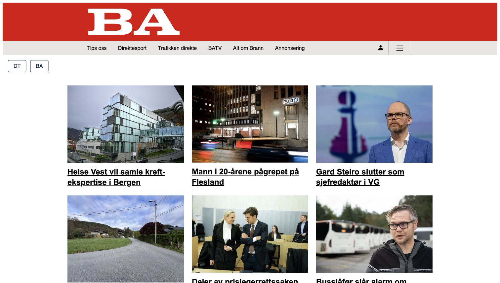

# Teaserskrift: før og etter

Lokal visuell kontroll av BA-preview 12. oktober 2026, utført av Codex på Runes bestilling.

- URL: `http://localhost:8080/frontpage-case/preview?publication=www.ba.no`
- Fil: `public/frontpage.css`, selektor `amedia-frontpage`.
- Endring: `font-family: 'Comic Sans MS', sans-serif` → `font-family: Arial, sans-serif`.
- Effekt: teaseroverskriftene bruker Arial. Header og avisvelger beholder sin styling.
- Tilbakeføring: sett font-family tilbake til førverdien og last siden på nytt.
- Kontroll: samme BA-side, viewport 1512 × 857 og samme synlige saker i begge bilder. Endringen ble også reversert og påført igjen under kontrollen fordi første oppdatering hentet en ny sak fra API-et.
- Avgrensning: lokal visuell kontroll, ikke automatisert test, publisering eller full responsiv verifikasjon. CSS-endringen og bildene er utført av Codex, ikke en selvstendig CSS-prøve av Rune.

## Før

## Etter

